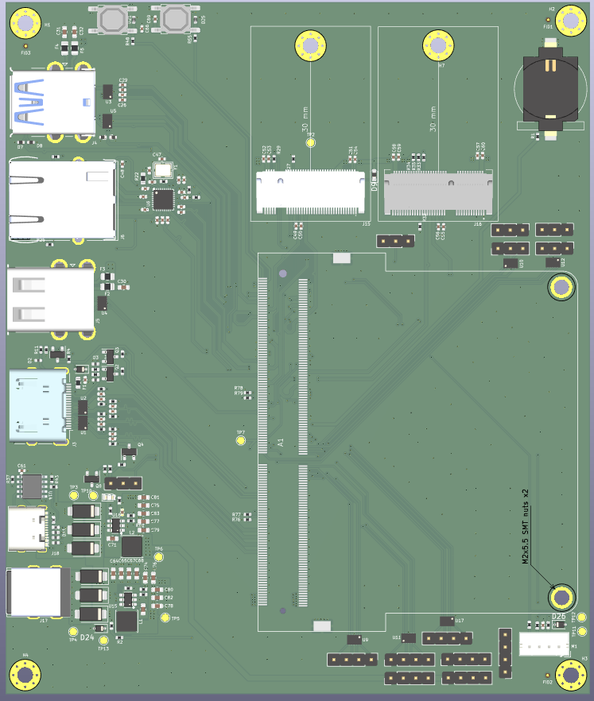
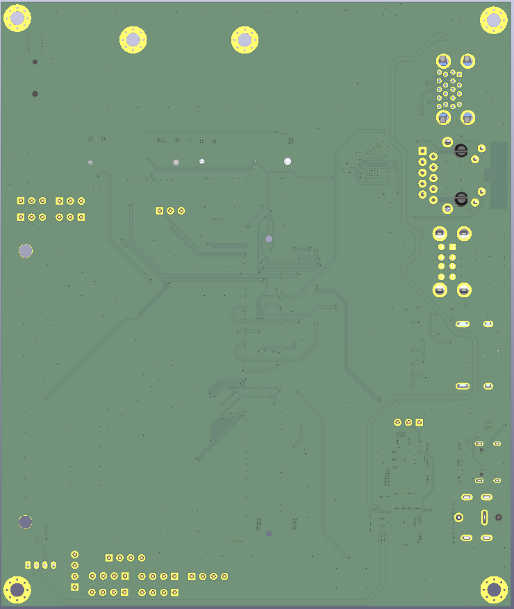

# 🐼 Custom LattePanda Mu Lite Carrier Board - Complete Hardware Implementation


## 📖 Project Overview & Engineering Scope
This repository hosts a **fully custom-engineered 4-layer PCB layout, physical routing, and mechanical integration** for the **LattePanda Mu Lite Carrier Board**. 

While the core electrical connectivity references the open-source hierarchical schematic architecture provided by DFRobot for compatibility with the **LattePanda Mu Compute Module** (an x86 processor module featuring integrated RAM and eMMC), **100% of the physical board implementation, trace impedance/width calculations, component footprint verification, 3D mechanical alignment, and high-speed signal routing were executed from scratch by Görkem Güven.**

Designing a carrier board for an x86 compute module is not a simple point-to-point routing task; it requires strict adherence to high-speed design rules, power delivery network (PDN) stability, electrostatic discharge (ESD) protection strategies, and precise mechanical tolerances. Every single trace, via, copper pour, and component placement on this board has been meticulously calculated and manually routed.

---

## 🖼️ 3D PCB Renders & Physical Layout Analysis

Below are the 3D mechanical and copper-routed views generated directly from KiCad, showcasing the placement topology and signal distribution across the board:

| Top View (`Latte_panda_mu_3D_top.png`) | Bottom View (`Latte_panda_mu_3D_bottom.png`) |
| :---: | :---: |
|  |  |

### 🔍 Top View Architectural Breakdown (`Latte_panda_mu_3D_top.png`)
* **Compute Module Core (`A1` Socket & Mechanical Mounting):** Located in the central-right zone, the high-density dual-row SMD connector (`A1`) interfaces directly with the LattePanda Mu module. To the far right, two **M2x5.5 SMT nuts (`H5`, `H6`)** are aligned within the module's mechanical outline to securely anchor the x86 board without inducing mechanical stress on the SMD pins.
* **Dual M.2 Expansion Slots (Top Center):** Two vertical 30mm M.2 sockets (`J15` and `J16`) are positioned at the upper edge with dedicated mounting standoffs, routed with length-matched differential pairs directly from the `A1` socket for high-speed NVMe/PCIe and wireless connectivity.
* **Perimeter I/O Coastline (Left Edge):** All external user-facing connectors are cleanly aligned along the left board edge for seamless enclosure integration:
  * **Top-Left (`J4`):** Dual-Stacked USB 3.0 Type-A receptacle (blue insert) backed by ultra-low capacitance ESD arrays (`U3`, `U5`).
  * **Upper-Mid Left (`J6`):** Gigabit Ethernet RJ45 Magjack (`RB1-125B8G1A`) paired directly with the Ethernet controller IC (`U6`), crystal oscillator (`Y1`), and termination passives.
  * **Mid-Left (`J5`):** Dual-Stacked USB 2.0 Type-A receptacle protected by 6V/1A polyfuses (`F2`, `F3`), bulk capacitance (`C30`), and a `D3V3XA4B10LP` TVS diode array (`U4`).
  * **Lower-Mid Left (`J3`):** HDMI output port with dedicated level-shifting and inline ESD protection along the TMDS differential lanes.
* **Power Delivery Network - PDN (Bottom-Left):** Features the primary power inputs (`J17`, `J18`) feeding two isolated high-efficiency DC-DC synchronous buck converter stages (`U15`/`L1` and `U16`/`L2`). Surrounded by high-current power inductors, Schottky diodes, and dense input/output capacitor banks (`C64`–`C83`) to guarantee low-ripple voltage rails under heavy x86 CPU loads.
* **System Control, RTC & Headers (Top-Right & Bottom-Right):** Includes a coin-cell RTC battery holder (top-right), tactile power/reset buttons (`SW1`, `SW2` at top-left), PWM fan connector, and dual-row GPIO expansion headers along the bottom-right perimeter.

### 🔍 Bottom View Architectural Breakdown (`Latte_panda_mu_3D_bottom.png`)
* **Continuous Ground Reference Plane (`B.Cu`):** The bottom layer is predominantly flooded with a solid, low-impedance `GND` copper pour, stitched extensively with ground vias to provide clean return paths and EMI shielding for the high-speed signals routed on the top and inner layers.
* **Impedance-Controlled Escape Routing:** Displays secondary differential pair breakouts and impedance-matched traces escaping from the central `A1` compute socket area toward the M.2 slots and peripheral headers, avoiding unnecessary layer transitions.
* **Through-Hole Mechanical Anchoring & Isolation:** Clearly exhibits the staggered 18-pin THT footprint of the Dual USB 3.0 port, the 8-pin + shield tabs of the Dual USB 2.0 port, the RJ45 Magjack pin array, and the four corner mounting holes (`H1`–`H4`) with exposed ground-ring pads for chassis grounding.

---

## ⚙️ Deep-Dive: Engineering & Design Process

Throughout the development of this carrier board, several critical hardware engineering challenges were analyzed and resolved:

### 1. High-Speed Signal Integrity & 4-Layer Stackup Routing
The LattePanda Mu module exposes high-speed interfaces including **PCIe Gen 3.0 (x4)**, **USB 3.0 (SuperSpeed 5Gbps)**, **USB 2.0**, **Gigabit Ethernet (MDI)**, and **HDMI/DisplayPort**.
* **Differential Pair Routing:** All high-speed differential pairs (`USB3_TX/RX`, `USB2_D+/D-`, `PCIe`, `HDMI`, and `Ethernet`) were manually routed with strict length matching, phase tuning, and symmetrical geometry to prevent signal skew and electromagnetic interference (EMI).
* **Reference Planes:** A dedicated 4-layer stackup was utilized to ensure continuous, unbroken Ground (`GND`) reference planes directly beneath high-speed traces, minimizing return path inductance and crosstalk.

### 2. Custom Footprint Verification & Multi-Source 3D CAD Integration
Standard library footprints often fail to represent complex multi-port connectors accurately. A major phase of this project involved auditing pinouts, verifying mechanical datasheets, and integrating accurate 3D STEP models:
* **LattePanda Mu A1 Compute Socket:** Configured the dense dual-row SMD connector (`A1`) alongside precise mechanical alignment for the module's **M2x5.5 SMT mounting nuts (`H5`, `H6`)**. Imported and manually calibrated the X-Y-Z offsets and rotation axes of the physical compute module's 3D CAD model to verify vertical and horizontal component clearances under the module.
* **Dual-Stacked USB 3.0 Type-A (`J4` / 18-Pin):** Standard component search engines frequently misrepresent stacked connectors with single-port 3D models. Cross-referenced multiple industrial part numbers (including **Amphenol `GSB311131HR`**, **Molex `48408-0003`**, **TE `1932799-1`**, and **Würth `692212030100`**), verified the 18-pin dual-row staggered through-hole footprint + 4 mechanical shield tabs, and integrated a true dual-stacked STEP model.
* **Dual-Stacked USB 2.0 Type-A (`J5`):** Verified the 8-pin dual-port power and data architecture (`VBUS1/2`, `D1+/D1-`, `D2+/D2-`) paired with dedicated polyfuse overcurrent protection (`F2`, `F3` - 6V/1A) and bulk decoupling (`22uF/10V`).
* **Gigabit Ethernet Magjack (`RB1-125B8G1A`):** Sourced and aligned the UDE integrated transformer RJ45 connector with built-in status LEDs, ensuring proper isolation clearance between the chassis ground and digital ground.

### 3. Electrostatic Discharge (ESD) & Power Protection Architecture
External I/O ports are highly vulnerable to transient voltage spikes and human-body ESD events. To ensure industrial-grade reliability:
* **Ultra-Low Capacitance TVS Arrays (`D3V3XA4B10LP`):** Placed directly adjacent to the USB connectors in a flow-through routing topology. This minimizes stub length and clamps transient voltages on `CON_USB1_D_P/N` and `CON_USB2_D_P/N` lines before they can reach the x86 compute module.
* **Compact 0402 ESD Protection (`ESD5V0B03`):** Integrated 0402 metric package bidirectional TVS diodes across auxiliary I/O and control lines, optimizing board real estate without compromising protection.

### 4. Design for Manufacturing (DFM) & Design Rule Check (DRC) Resolution
A board that only looks good in CAD is useless if it fails on the SMT assembly line. Extensive DRC and DFM audits were conducted to make the board production-ready:
* **Optical Fiducial Marker Clearance (`FID1`, `FID2`, `FID3`):** Resolved critical *"Front solder mask aperture bridges items with different nets"* errors. Because fiducial markers are un-netted copper pads (`<no net>`), the surrounding `GND` copper pours across `F.Cu` and inner layers were encroaching on the solder mask opening. Custom local copper clearance rules were applied to pull back the `GND` zone, ensuring high-contrast optical recognition for automated Pick-and-Place (SMT) vision systems.
* **Mechanical Courtyard Overlaps (`A1` vs `H5`/`H6`):** Analyzed and validated the intentional courtyard intersections between the LattePanda Mu's overarching mechanical boundary (`A1`) and the structural SMT securing nuts (`H5`, `H6`).

---

## 🧩 Modular Hierarchical Architecture
The electrical design is organized into clean, modular hierarchical schematic sheets to separate power domains and high-speed subsystems:

| Schematic Sheet | Subsystem Description |
| :--- | :--- |
| `LattePandaMu_carrier_custom.kicad_sch` | Top-level master sheet mapping global labels and hierarchical interconnects. |
| `LattePanda_Module.kicad_sch` | Core A1 high-density connector pinout mapping for the x86 module. |
| `psu.kicad_sch` | Power Supply Unit, DC-DC buck converters, voltage rails, and power sequencing. |
| `usb_2_3.kicad_sch` | USB 3.0 SuperSpeed & USB 2.0 host controllers, VBUS protection, and ESD arrays. |
| `ethernet.kicad_sch` | Gigabit Ethernet MDI routing, magnetics termination, and RJ45 LED interface. |
| `pciex4.kicad_sch` | High-speed PCIe Gen3 x4 lane routing and AC coupling capacitors. |
| `m2_em_key.kicad_sch` | M.2 E-Key / M-Key socket implementation for NVMe SSD and wireless expansion. |
| `hdmi.kicad_sch` | TMDS differential video routing, level shifting, and HPD/DDC protection. |
| `gpio.kicad_sch` & `fan.kicad_sch` | Active thermal management (PWM fan control) and general-purpose I/O headers. |

---

## 📂 Repository File Structure

```text
├── production/
│   ├── Gerber_Latte_panda.zip                 # Ready-to-manufacture Gerber & Excellon Drill files
│   └── bom.csv                                # Complete Bill of Materials (BOM) for SMT assembly
├── Libraries/                                 # Project-specific custom footprints, symbols, and 3D STEP models
├── LattePandaMu_carrier_custom_Sch.pdf        # Complete searchable PDF of all hierarchical schematics
├── Latte_panda_mu_3D_top.png                  # High-resolution 3D render (Top View)
├── Latte_panda_mu_3D_bottom.png               # High-resolution 3D render (Bottom View)
├── Latte_panda_mu_Footprint_Layer_1.png       # Layer 1 (F.Cu - Top Signal & Component Layer)
├── Latte_panda_mu_Footprint_Layer_2.png       # Layer 2 (In1.Cu - Internal Ground/Power Plane)
├── Latte_panda_mu_Footprint_Layer_3.png       # Layer 3 (In2.Cu - Internal Signal/Power Plane)
├── Latte_panda_mu_Footprint_Layer_4.png       # Layer 4 (B.Cu - Bottom Signal & Decoupling Layer)
├── LattePandaMu_carrier_custom.kicad_pro      # KiCad Project File
├── LattePandaMu_carrier_custom.kicad_pcb      # Custom 4-Layer PCB Layout File
├── *.kicad_sch                                # Main and sub-sheet hierarchical schematic files
└── fp-lib-table & sym-lib-table               # Library mapping tables
